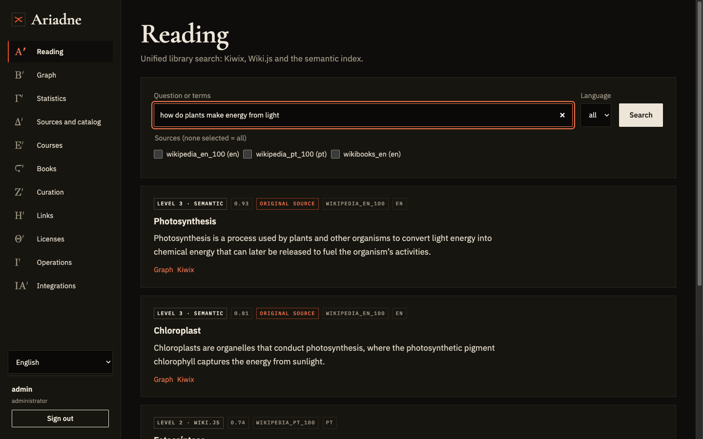
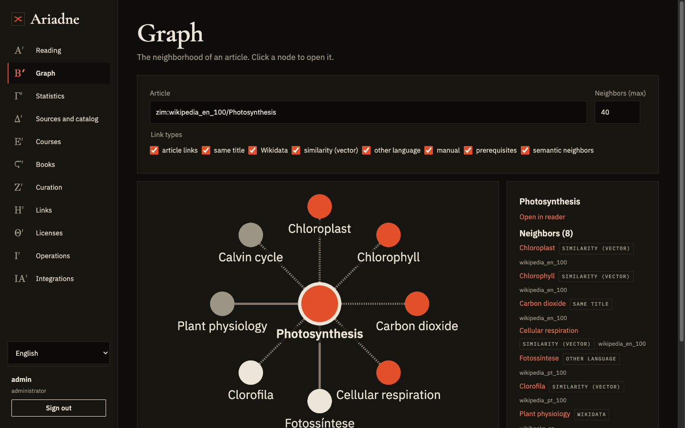

<p align="center">
  
</p>

<h1 align="center">Ariadne</h1>

<p align="center">
  <strong>The thread that guides you through the labyrinth.</strong><br>
  A self-hosted, offline memory for AI agents and people — built on Kiwix, Wiki.js and pgvector, served over MCP and REST, and light enough to run on a plain CPU.
</p>

<p align="center">
  <a href="LICENSE"></a>
  <a href="https://github.com/VivaldiCode/Ariadne/actions/workflows/ci.yml"></a>
  
  
  
</p>

<p align="center">
  <a href="#quickstart">Quickstart</a> ·
  <a href="#what-you-get">Features</a> ·
  <a href="#how-it-works">Architecture</a> ·
  <a href="#connect-an-agent">Connect an agent</a> ·
  <a href="#documentation">Docs</a> ·
  <a href="#roadmap">Roadmap</a> ·
  <a href="#contributing">Contributing</a>
</p>

---

Language models are trained on a frozen snapshot of the world, and the web is a poor place to look things up offline.
**Ariadne turns a library of [Kiwix](https://kiwix.org) archives (Wikipedia, Wikibooks, Stack Exchange, Gutenberg, manuals…)
into one connected, searchable memory** that an agent — or you — can query, read, cite and follow from article to article,
across files and across languages. Nothing leaves your machine.

It is built around one idea: a model does not need to *know* everything, it needs to know **where and how to look**.
Ariadne is the place to look, and the long-term goal is to train small models that search it, cite it and say when they
do not know (see [`ARCHITECTURE-TRAINING.md`](ARCHITECTURE-TRAINING.md)).

<p align="center">
  
  
  <br>
  <sub>The web app: unified search (left) and the link graph of an article (right). Screenshots use a small demo library.</sub>
</p>

## Quickstart

You need Docker with Compose v2 (≥ 2.20), about 8 GB of RAM and 20 GB of disk if you switch every profile on. No GPU.

```bash
git clone https://github.com/VivaldiCode/Ariadne.git ariadne && cd ariadne
deploy/standalone/init-env.sh && docker compose up -d --build
docker compose logs bootstrap        # your admin API key is printed here, once
```

Then open **http://localhost:8800** and sign in with that key. The MCP endpoint is `/mcp`, the REST API is documented at
`/docs`, and `curl localhost:8800/health` should report every check as `ok`.

The first start is slow (it builds `kiwix-serve` and `llama.cpp`, installs Moodle and downloads the models). To try things
with almost no download, fetch a 1.8 MB test archive first: `deploy/kiwix/get-test-zim.sh`. Real libraries can be added from
the web app (*Sources and catalog* → Kiwix catalog) or by dropping `.zim` files in `./data/zim`.

Profiles, what `bootstrap` does for you, upgrades and known issues: [`docs/STANDALONE.md`](docs/STANDALONE.md).

## What you get

- **One memory, three levels.** Raw archives (Kiwix) for completeness, a curated and linked rewrite (Wiki.js) for reading,
  and a semantic index (pgvector) that **grows with use**: what gets asked gets embedded, instead of vectorizing the whole
  library up front.
- **A connected knowledge graph.** Links between archives (same title, Wikidata, vector similarity) and between languages,
  with the original-language article marked as the source. Follow them with the `neighbors` and `translations` tools or in
  the graph view.
- **MCP and REST, one service.** Eight tools for agents (`search`, `read`, `neighbors`, `translations`, `translate`,
  `sources`, `rooms`, `feedback`) and a matching API. Every call is logged, so you can see what is used, by whom, and what
  helped.
- **Topic rooms.** Articles of each source are clustered into *wings* and *rooms* (MemPalace-style) that narrow searches and
  neighborhoods.
- **Local translation.** LibreTranslate on your own CPU, without touching code blocks or quotations.
- **Courses with auto-grading.** A canonical course format in Git, published to Moodle with CodeRunner and a sandboxed Jobe
  runner (freeCodeCamp import included).
- **Books.** Calibre and Kavita, chapters extracted and searchable, with *open* and *private* license classes that gate what
  may leave the machine.
- **A curator on CPU.** A small local model rewrites and checks articles, with human review, fidelity checks and an optional
  external GPU batch (Kaggle) when you want faster throughput.
- **A web app to run it all.** Reading, graph, statistics, sources and catalog, courses, books, curation, links, licenses,
  operations and integrations. English by default, Portuguese included, and easy to extend ([`CONTRIBUTING.md`](CONTRIBUTING.md)).
- **Backups and encrypted releases.** Local dumps and a weekly encrypted, signed, chunked release.
- **No models of Chinese origin.** The project ships none, and a guard refuses them at startup.

## How it works

```mermaid
flowchart LR
    agents["Agents<br/>(Claude, your own LLM)"] -- "MCP / REST" --> server
    people["People<br/>(web app)"] -- "HTTPS" --> server

    subgraph core["ariadne"]
        server["server<br/>router · access log"]
        worker["workers<br/>indexer · linker · rooms<br/>importer · curator"]
        server -- "index queue" --> worker
    end

    server --> l3[("Level 3<br/>pgvector")]
    server --> l2["Level 2<br/>Wiki.js"]
    server --> l1["Level 1<br/>kiwix-serve / libzim"]
    worker -- "embeddings (CPU)" --> l3
    worker -- "curated import" --> l2
    l1 -- "ZIM files" --> worker
    catalog["Kiwix catalog"] -.-> l1
    l2 --- pg[("Postgres")]
    l3 --- pg
```



| Level | What it holds | Built on | Strength |
|---|---|---|---|
| **1 — Archive** | The ZIM files, untouched | `kiwix-serve`, `python-libzim` | Complete and compact; always available |
| **2 — Wiki** | Curated, linked pages | Wiki.js + Postgres | Human-readable, editable, cross-source links |
| **3 — Semantic** | Vectors of what is used, and of its neighbors | Postgres + pgvector | Fast multilingual semantic search that grows with use |

A search first asks the semantic level; when confidence is low it falls back to the wiki and the archive, and anything
useful that it found is queued for indexing. Hot documents expand their neighborhood within a daily budget. The full
reasoning, the data model and the trade-offs are in [`ARCHITECTURE.md`](ARCHITECTURE.md).

### Profiles

The core (`postgres`, `kiwix`, `server`, workers) always starts. Everything else is a Compose profile you choose in
`COMPOSE_PROFILES` (default `all`):

| Profile | Adds | When you want it |
|---|---|---|
| `wiki` | Wiki.js (level 2), set up for you by `bootstrap` | A curated, browsable rewrite of your library |
| `books` | Calibre + Kavita | Ebooks, extracted by chapter and searchable |
| `courses` | Moodle + CodeRunner + Jobe sandbox | Courses with auto-graded exercises |
| `translate` | LibreTranslate | Local machine translation (en + pt out of the box) |
| `llm` | A curator model served by `llama.cpp` on CPU | Automatic rewriting and checking of articles |

Leave a profile off and its URL empty in `.env`, and Ariadne simply treats that service as *not configured*.

### Hardware

Ariadne is designed for modest, old and CPU-only hardware, and that is tested, not a footnote:

- **x86-64 with SSE4.2 is enough** — no AVX, AVX2, FMA or F16C needed (the reference machine is a pair of 2009-era Xeon
  X5550s with 128 GB of RAM). It also runs on Apple Silicon.
- **No GPU, no ROCm, no PyTorch on the server.** Embeddings run through ONNX Runtime (int8), and the optional curator through
  `llama.cpp` built without native CPU flags. Any new native dependency has to pass the embedding benchmark canary
  ([`bench/embeddings`](bench/embeddings/README.md)) before it can enter the server.
- Heavy offline jobs (the initial embeddings, training) can run on a workstation or an external GPU batch and be imported back.

## Connect an agent

```bash
docker compose exec server ariadne principal create --kind agent --name claude-code
claude mcp add --transport http ariadne http://localhost:8800/mcp --header "Authorization: Bearer <key>"
```

Clients that only speak stdio (Claude Desktop, for example) can run `ariadne mcp-stdio` with the key in `ARIADNE_API_KEY`.

| Tool | What it does |
|---|---|
| `search(query, lang?, sources?, k?)` | Search over the three levels: title, snippet, source, language, level, `document_id` |
| `read(document_id, section?, max_chars?)` | Clean text of a document or section, plus its outline and links |
| `neighbors(document_id, kinds?, k?)` | Linked documents: other sources and languages, similar articles, internal links |
| `translations(document_id)` | The same topic in other languages, with the original-language version flagged |
| `translate(text, target, source?)` | Local translation that leaves code and quotations alone |
| `sources()` / `rooms(wing?)` | What is in the library, and its topic rooms |
| `feedback(query_id, document_id, useful)` | Tell Ariadne whether a result helped |

## Documentation

| | |
|---|---|
| [`docs/STANDALONE.md`](docs/STANDALONE.md) | Running the whole stack on one machine: profiles, bootstrap, upgrades, known issues |
| [`ARCHITECTURE.md`](ARCHITECTURE.md) | The knowledge service: design, data model, decisions and their reasons |
| [`STRUCTURE.md`](STRUCTURE.md) | The system at a glance: articles, courses, books, curation, licenses, infrastructure |
| [`ARCHITECTURE-TRAINING.md`](ARCHITECTURE-TRAINING.md) | The second layer: small models trained to search Ariadne |
| [`docs/WIKI-IMPORT.md`](docs/WIKI-IMPORT.md) | Importing into Wiki.js and the external GPU batch (Kaggle) |
| [`bench/embeddings`](bench/embeddings/README.md) | The embedding benchmark for CPUs without AVX |

Development: `cd server && uv run pytest && uv run ruff check . && uv run mypy`, and `cd web && npm ci && npm test`.
Details, including the test services, are in [`CONTRIBUTING.md`](CONTRIBUTING.md).

## Roadmap

Shipped (phases 0–12 of the plan in [`ARCHITECTURE.md`](ARCHITECTURE.md)): the CPU embedding benchmark, MCP and REST over
the archive, usage-driven semantic indexing, neighbors and the cross-source graph, the Wiki.js level with curation, language
links and local translation, the web app, wings and rooms, courses (Moodle + CodeRunner + Jobe), books (Calibre + Kavita)
with license classes, the Kiwix catalog in the app, backups and encrypted releases, and the one-machine Compose distribution.

Next:

- Decide the default embedder from benchmarks on the reference hardware.
- Run the curation backlog at scale and publish quality numbers.
- Train and evaluate small "researcher" models that search and cite Ariadne ([plan](ARCHITECTURE-TRAINING.md)).
- Translate the code comments (they are in Portuguese for now) and extend the UI to more languages.

Ideas and priorities are discussed in the issues.

## Contributing

Contributions are welcome, from typo fixes to new importers. Read [`CONTRIBUTING.md`](CONTRIBUTING.md) and the
[`CODE_OF_CONDUCT.md`](CODE_OF_CONDUCT.md). Please report vulnerabilities privately, as described in
[`SECURITY.md`](SECURITY.md), never in a public issue.

This repository is generated from the maintainer's development repository, with one commit per release.

## License

[AGPL-3.0](LICENSE). If you host a modified version for other people, you must offer them the source. Third-party services
and fonts keep their own licenses (see `deploy/tema-ariadne/fonts`).

Project page: https://ariadne-project.com
