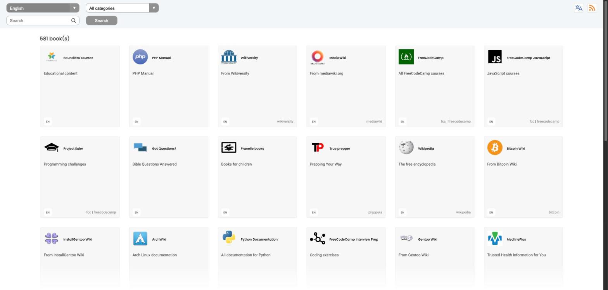
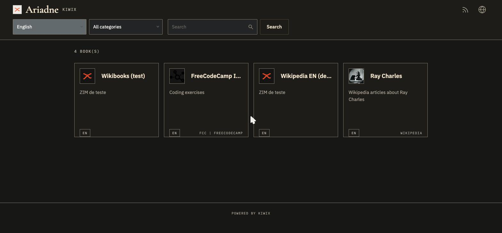
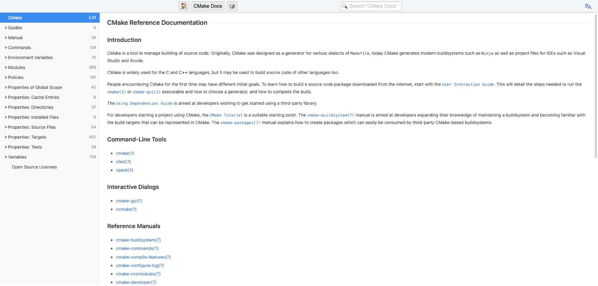
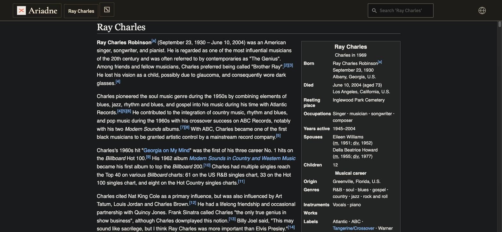
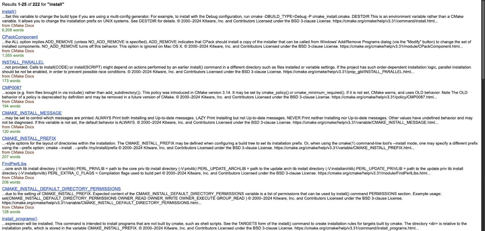
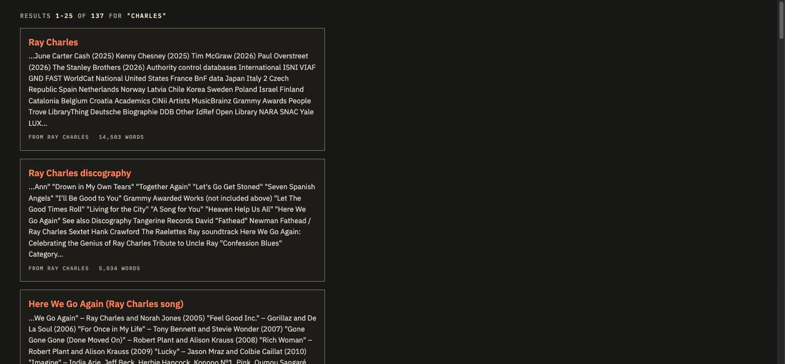

# kiwix-serve with the Ariadne skin

The kiwix-serve skin comes compiled into libkiwix, so this image compiles it again with our files on top. The result has the
same design system as the dashboard (`web/`) and the Wiki.js theme (`deploy/wikijs-theme`): Ink background, Thread as the
only accent colour, Cormorant Garamond for titles, IBM Plex for text and labels, 48 px buttons with a 2 px radius, Ink 2
cards with Line borders and square corners, and 16/24/40 px gutters.

| What | Where |
|---|---|
| CSS (home page, reader, search, errors) | `static/skin/*.css` |
| Templates (header with the brand, «no JavaScript» page, search, errors) and `viewer.html` (the reader's top bar) | `static/templates/`, `static/viewer.html` |
| Icons (language, feed, search, errors) | `static/skin/*.svg` |
| Tokens and fonts (shared with Wiki.js) | `../tema-ariadne/` → `/skin/ariadne/ariadne.css` and `/skin/ariadne/fonts/` |
| Image | `Dockerfile` (the base is `ghcr.io/kiwix/kiwix-serve:3.8.2`, the same as in `docker-compose.yml`) |

`kiwix-manage`, `start.sh`, `dumb-init`, the user, the ports (8080) and `/data` come from the official image: it is a direct
replacement, with the same volumes, port and arguments. **Only `kiwix-serve` changes**; the APIs that Ariadne depends on
(`/catalog/v2/entries`, OPDS, `/search?books.id=…`, `/content/…`) are not touched. The original JavaScript (`index.js`,
`viewer.js`) is not touched either: only the CSS, the templates and the icons.

Versions are pinned in the `Dockerfile` (arguments): kiwix-tools 3.8.2, libkiwix 14.2.1, libzim 9.8.2. To upgrade, change the
argument and test the skin again, because the original templates may have changed.

## Build and publish

```sh
deploy/kiwix/build.sh              # linux/amd64, pushes $REGISTRY/kiwix-serve:<commit> and :latest ($REGISTRY is required)
PUSH=0 deploy/kiwix/build.sh dev   # local only, for the Docker platform (to see the skin on a Mac)
```

The target is the data server (Xeon X5550, no AVX): the build uses only `-O2`, never `-march=native`.

## View the skin locally

```sh
docker run --rm -p 8080:8080 -v "$PWD/data/zim:/data:ro" ariadne/kiwix-serve:dev "<file>.zim"
```

## What does not change

The content of the ZIM files (what appears inside the reader) keeps the style of each ZIM; the skin only covers the library,
the reader's top bar, search results and error pages.

## Screenshots

| Before | After |
|---|---|
|  |  |
|  |  |
|  |  |

(The «after» screenshots come from a local container with the published image and a test ZIM; the «before» ones come from the server.)
