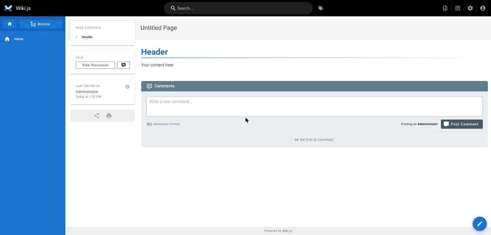
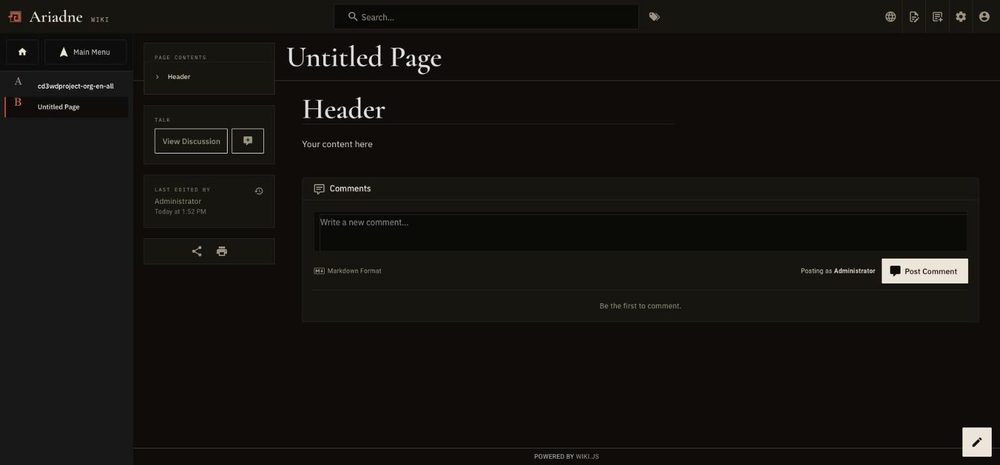
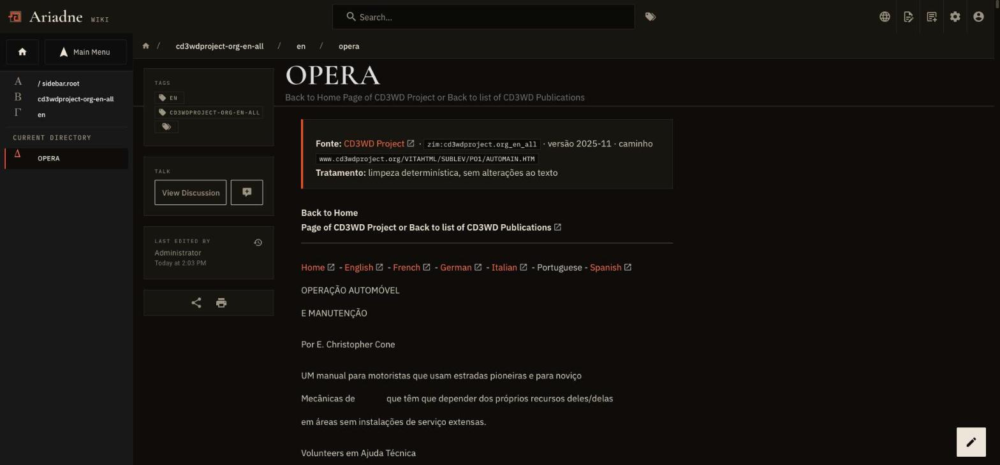
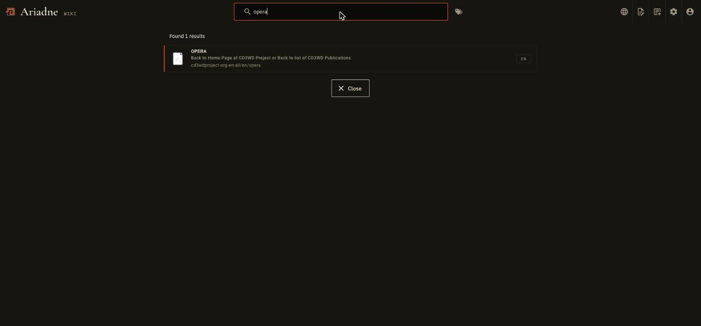
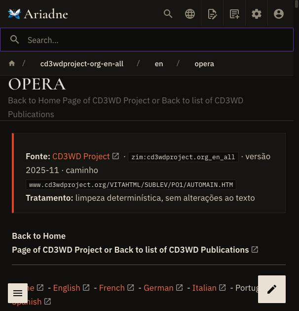

# Wiki.js theme (Ariadne design system)

Wiki.js uses the same design system as the dashboard (`web/`) and Kiwix (`deploy/kiwix`): a single theme, the dark one, with
Ink as the background, Bone and Body for text, **Thread as the only accent colour**, Cormorant Garamond for titles, IBM Plex
Sans for text and IBM Plex Mono for labels. Source of truth: Penpot (file «Ariadne Design System»).
The tokens (`--ink`, `--bone`, `--thread`, `--space-m`, …) have the same names and values as `web/src/styles/tokens.css`
and live in [`../tema-ariadne/`](../tema-ariadne/), shared with Kiwix.

| File | Where it goes (Administration → Theme) |
|---|---|
| `theme.css` (generated) | **CSS Override** |
| `head.html` | **HTML injection in head** (loads the fonts and the icon) |
| `logo-url.txt` | **Administration → General → Logo URL** (the Ariadne brand) |
| `body.html` | **HTML injection in body** (script that turns wide tables into cards on mobile) |
| `wiki.css` | source of `theme.css` (tokens + `wiki.css`) |

Besides the three fields, turn on **Dark mode** (same page) and set the Ariadne logo (see below). Wiki.js must be version 2.5.

## Reapply

1. `deploy/wikijs-theme/build.sh` generates `theme.css` (DS tokens + `wiki.css`).
2. In Wiki.js, **Administration → Theme** (`/a/theme`):
   - theme `Default`, **Dark mode** on;
   - **CSS Override**: paste `theme.css`;
   - **HTML injection in head**: paste `head.html`;
   - **HTML injection in body**: paste `body.html`;
   - **Apply**.
3. Reload the pages (Ctrl+Shift+R): Wiki.js caches the theme.

## The logo

The logo is the Ariadne brand mark from Penpot («01 · Logo» → Mark): the labyrinth with the thread entering, in
[`../tema-ariadne/logo-mark.svg`](../tema-ariadne/logo-mark.svg). In **Administration → General → Logo**, in the
**Logo URL** field, paste the contents of [`logo-url.txt`](logo-url.txt) (it is the same SVG, embedded as a `data:` URI, so it
does not depend on any server) and **Apply**.
The site title («Wiki.js») is hidden by the CSS, and the brand shows «Ariadne» + `WIKI`.

## The fonts come from Kiwix

`head.html` loads `https://<your-kiwix>/skin/ariadne/ariadne.css` (replace `<your-kiwix>` with the public address of your Kiwix
before pasting it into Wiki.js). This is the tokens and `@font-face` file that our kiwix-serve image
([`../kiwix`](../kiwix)) serves at `/skin/ariadne/`, with the fonts (Cormorant Garamond, IBM Plex Sans and Mono, GFS Didot;
all under the SIL OFL) in `fonts/`. kiwix-serve already responds with `Access-Control-Allow-Origin: *`, so Wiki.js can use them
from another domain. If Kiwix is down or the official image is used, Wiki.js falls back to the system fonts (Georgia,
system-ui, monospace): it stays readable and only loses the typography.
No third-party requests; the fonts are included.

## What the theme does

- **Header:** Ink 2 bar with a Line border; the brand is the thread icon and «Ariadne» in Cormorant, with the `WIKI` label in
  mono (the site title is hidden by CSS, so the brand is the same whatever title is set in the settings). Search in an Ink 0
  field, 48 px.
- **Navigation:** the sidebar is the dashboard's: Ink 2, right border, 44 px entries with Greek numerals (Αʹ Βʹ Γʹ…) and the
  thread on the left edge of the active entry.
- **Components:** 48 px buttons (primary in Bone, secondary as a Bone outline, 2 px radius), Ink 2 cards with Line borders and
  square corners, labels in mono, notices (`blockquote`) with the thread on the left edge, tables with a mono header.
- **Content:** page title in Cormorant, body in Plex 17/1.65 with a 70-character measure, code in Ink 0.
- **Mobile:** 16/24/40 px gutter depending on the screen; wide tables become cards (DS rule); nothing slides sideways.
- **Accessibility:** 2 px focus ring in Thread text with a 3 px offset; no animations or animated hover effects.

## Revert

The previous theme was the light `Default`, with no injected CSS or HTML: in **Administration → Theme**, turn off
**Dark mode** and empty the three fields.

## Screenshots

| Before | After |
|---|---|
|  |  |
| |  |
| |  |
| |  |

(In the «after» screenshots the fonts come from a local copy of our Kiwix image, which serves exactly the same files.)
